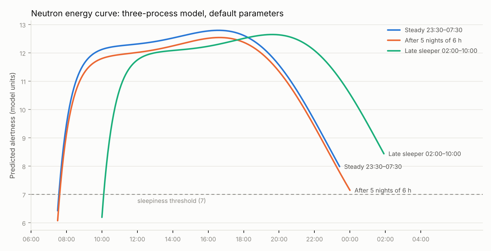

# Commander model

How Commander turns sleep history into a sleep-need estimate, a sleep-debt number and a daily energy curve, food and weight logs into calorie and macro targets (§10), training logs into a lifting program, an endurance plan and mobility work (§11), and all of it into a daily stats hexagon (§12). Every parameter has a source or is labelled **ASSUMPTION** or **RECONSTRUCTED**. The executable version is `tools/model-reference/commander_model.py`; `check_model.py` runs the behavioural checks below.

Commander is a personal wellness tool. Nothing here diagnoses or treats a sleep disorder or any other condition.

---

## 1. Inputs

| Input | Where it comes from |
|---|---|
| Sleep episodes (start, end, nap or night) | Phone-inferred, Health Connect, or manual (§6) |
| "Woke without an alarm?" per night | Morning check-in |
| Sleepiness ratings, KSS 1–9 | Optional check-ins (§5) |
| Target wake time | Settings |

All times are stored as instants plus UTC offset. Clock hours are computed in the zone the user was in at that instant.

## 2. Energy curve: three-process model of alertness

Predicted alertness `A(t) = S + C + U + W`, the three-process model (TPM) of Åkerstedt and Folkard, which extends Borbély's two-process model of sleep regulation [1]. Parameters are the defaults reported by Ingre et al. 2014 [3] unless noted.

**Process S, homeostatic** (t in hours)

- Awake: `S(t) = la + (S_wake − la)·e^(d·t)`, la = 2.4, d = −0.0353
- Asleep: `S(t) = ha − (ha − S_sleep)·e^(g·t)`, ha = 14.3, g = ln((14.3 − 14.0)/(14.3 − 7.96))/8 ≈ −0.3813, i.e. S goes from 7.96 to 14.0 over 8 h of sleep [3]
- Ingre et al. add a "brake" that slows recovery above S = 12.2 [3]. Its exact form is in an equation image I could not read as text, so v1 **omits it**. Effect: recovery late in a long night is slightly faster than the published model.

**Process C, circadian**: `C(t) = Ca·cos(2π(t − p)/24)`, Ca = 2.5, p = 16.8 h (clock time of peak) [3].

**Process U, 12-hour component**: `U(t) = Um − Ua·cos(2π(t − (p − 3))/12)`, Ua = 0.5, Um = −0.5 [3]. **RECONSTRUCTED:** the phase (trough 3 h before p, so 13:48 by default) comes from the text of Åkerstedt, Folkard and Portin 2004 [2]; the equation itself is an image in both papers.

**Process W, sleep inertia**: `W(t) = Wc·e^(Wd·t)`, Wc = −5.72, Wd = −1.51 per hour since waking [3].

**Scale.** In the 2004 description, about 3 is extreme sleepiness, 7 is the sleepiness threshold (slow eye movements appear) and 14 is high alertness [2]. Ingre et al. map alertness to the Karolinska Sleepiness Scale as `KSS = 10.6 − 0.6·A` [3]; KSS is the 1–9 scale of Åkerstedt and Gillberg [4].

### What the published model predicts

With default parameters, a steady 23:30–07:30 sleeper wakes at A ≈ 6.4 (below the threshold), is past grogginess within about an hour, rises to a **single peak at about 16:35**, and falls back to ~8 at bedtime. KSS at noon ≈ 3.2 ("alert").

Two things matter for the product:

- **No afternoon dip or evening second wind.** The 12-hour component is too small to beat the rising circadian term, so the curve flattens around 11:30–14:00 but never turns down. A Rise-style "two peaks and a dip" curve is not what this model predicts with its published defaults. → **D-25**: keep the published curve; your sleepiness ratings decide whether you have a dip.
- **Short nights barely accumulate.** Five nights of 6 h lower the mean daytime value only from 11.60 to 11.33, and day 5 looks like day 1. One 9 h night fully restores it. This is a known weakness of two-process-type models: they don't predict the effects of chronic restriction [14, 15], which Van Dongen et al. showed are cumulative and dose-dependent over 14 days [5], and which one recovery night does not reverse [6]. → **D-26**: debt is shown beside the curve, not baked into it; a chronic-restriction model is evaluated for a later version.

## 3. Sleep need

**Prior: 8.0 h.** The AASM/SRS consensus is that adults 18–60 should regularly sleep 7 h or more, with individual need varying [8]. In 15 young men given 12 h in bed for 9 nights, the estimated optimal duration was 8.41 h (range 7.29–9.26), about an hour more than their habitual sleep [7]. 8.0 sits inside that evidence; it is a starting point, not a measurement.

**Personal estimate.** A night qualifies if the user woke without an alarm **and** debt before that night was under 2 h (**ASSUMPTION**: after a big debt, natural sleep runs long because of rebound [7]). Need = `(5 × prior + Σ qualifying TST) / (5 + n)`. The prior counts as 5 nights of evidence (**ASSUMPTION**). The user can override need in settings.

## 4. Sleep debt

Debt = `max(0, Σ_{k=0..13} w_k·(need − TST_k))`, with linear recency weights `w_k = (14 − k)/14` (last night = 1.0).

- 14 nights matches the protocol over which Van Dongen et al. saw deficits keep accumulating [5]. The linear weights, the 0 floor and letting surplus nights pay debt down are **product decisions**, not physiology. Banks et al. found one long night does not erase several short ones [6], which recency weighting only roughly mimics.
- Nights with no data are skipped, not treated as 0 h.
- Debt is shown as hours with a band: low < 2 h, moderate 2–5 h, high > 5 h (**ASSUMPTION**: bands are for readability only).

Checks that pass: 14 × 8 h at need 8 h → 0; 14 × 7 h → 7.5 h; a short night last night outweighs the same short night two weeks ago; 14 × 10 h → 0.

## 5. Personalisation

**Circadian phase p.** Default p = 16.8 h [3]. For a first guess, Commander shifts p by how far the user's habitual mid-sleep is from 03:00 (**ASSUMPTION**: the default is treated as belonging to a ~23:00–07:00 sleeper), clamped to 13–21 h. Ingre et al. found phase does vary with self-rated chronotype, from 14.61 h for the most morning-type group to 16.62 h for the most evening-type [3], so a personal p is justified; the mid-sleep mapping is not.

**Calibration (replaces the guess).** After at least 20 KSS ratings over at least 7 days, fit p and Ua by least squares against `KSS = 10.6 − 0.6·A`, regularised toward the defaults, and adopt the fit only if it lowers error on held-out ratings (**ASSUMPTION** for the thresholds). Caveat: in Van Dongen et al., subjective sleepiness levelled off while performance kept falling [5], so a curve fitted to how you feel can understate accumulated debt. That is one more reason debt is shown separately.

## 6. Phone-only sleep detection

Without a wearable, Commander infers a **rest period** (phone down → phone up) from screen events and asks the user to confirm it each morning.

- **Signal.** Screen-on events from `UsageStatsManager` (`UsageEvents.Event.SCREEN_INTERACTIVE`), binned into 5-minute counts over a window from 18:00 to 15:00 next day, re-centred on habitual mid-sleep for late sleepers (**ASSUMPTION**). Phase 3 must check on your phone whether notifications that light the screen inflate the count; if so, switch to unlock events (`KEYGUARD_HIDDEN`).
- **Model.** Two Poisson rates, low inside the rest period and high outside; choose the start and end bins that maximise the likelihood, minimum 3 h. This follows SensibleSleep (Cuttone et al.), which used screen on/off events, tolerates the odd night-time phone check, and reported 0.89 accuracy against an activity-tracker armband [13]. On a synthetic night with a 3 a.m. check, the reference detector is within 5 minutes at both ends.
- **Limits.** Screen-off is rest, not sleep [13]. Lying awake, reading a book, or a phone left charging in another room all count as "asleep". The morning confirmation is the correction, so a confirmed night is the source of truth.
- **Health Connect.** If any app has written a `SleepSessionRecord` for that night, Commander uses it instead of inferring, and still asks for confirmation. I could not confirm that a phone without a wearable writes sleep sessions to Health Connect, so Commander does not rely on it.
- **Naps** are logged manually in v1. They feed Process S and count toward that day's sleep total (**ASSUMPTION**).

## 7. Daily orders derived from the curve

Implemented in `plan_day` / `plan_for_schedule` (Python) and `planDay` / `planForSchedule` (Kotlin).

| Order | Rule | Basis |
|---|---|---|
| Up, then outside light | Light within 1 h of waking | Light after the circadian low advances the clock, light before it delays it [12]; the 1 h window is an **ASSUMPTION** |
| Groggy | From waking until W > −1: ln(5.72)/1.51 ≈ 69 min | Process W [3]; the cut-off of 1 unit is an **ASSUMPTION** |
| Sharpest (estimate) | Contiguous stretch around the day's maximum where A is within 0.5 of it, searched between the end of grogginess and lights out | **ASSUMPTION**. With default parameters this is wide (≈ 12:35–19:20 for a 23:30–07:30 sleeper) because the curve is nearly flat; shown with its peak time and labelled an estimate |
| Dip (estimate) | Lowest strict local minimum in the same window, if any | §2; with default parameters there is none |
| Sleepiness sets in (estimate) | First time after the peak that A < 7, if before wind-down | Sleepiness threshold [2] |
| Next wake | Moves toward the target wake time, but at most 30 min earlier than the usual wake per day; a later target applies at once | Rule of command; 30 min is an **ASSUMPTION** |
| Lights out | Next wake − need − 15 min to fall asleep − debt allowance (15 min if debt 2–5 h, 30 min if > 5 h), but never more than 30 min earlier than habitual sleep onset | Need §3. Moving bedtime earlier is limited because sleep is hardest to start in the 2–3 h before habitual bedtime, the "forbidden zone" [10]. 15 min, the debt allowances and 30 min are **ASSUMPTIONS** |
| Last caffeine | 8 h before lights out | 400 mg 6 h before bed still cut sleep by over an hour [11], so the cutoff must be earlier than 6 h; 8 h is an **ASSUMPTION** |
| Melatonin rising (estimate) | Habitual sleep onset − 2 h | Sleep onset averages ≈ 2 h after melatonin onset, but the spread across people was 2.4 h in early sleepers and 4.5 h in late sleepers [9] |
| Wind down | 60 min before lights out; dim lights, screens away | Evening light delays the clock [12]; 60 min is an **ASSUMPTION** |

**Before real nights exist** (until Phase 3), the history is 20 identical nights of the user's stated usual schedule, debt is 0, habitual onset is the stated bedtime, and p is the mid-sleep first guess from §5. Because "usual" doesn't update on its own yet, the 30-minute steps repeat the first step each day until the user updates their usual times or detection arrives.

**Which day's orders.** Today's orders replace yesterday's 3 h before the usual wake time, so at 01:00 the screen still shows last night's lights out (**ASSUMPTION**).

**Travel and DST.** p is kept in body time. After a time-zone change it re-entrains toward the new local time at no more than 1 h per day (**ASSUMPTION**, to be sourced before Phase 4). DST nights are 23 or 25 h long and must not create or remove sleep.

## 8. What the checks cover

`python3 tools/model-reference/check_model.py` currently reports:

- **Pass (40):** steady state reached; groggy on waking; single peak near acrophase; noon KSS in "alert" range; restriction lowers alertness; late sleeper's curve shifts by the expected 3 h; four debt checks; two need checks; detection within 15 min despite a night-time check; the 10 fuel checks in §10; the 11 Train checks in §11.5; the 6 hexagon checks in §12.
- **Known limitations (3, reported every run, don't fail the build):** no afternoon dip/second wind; no accumulation across short nights; one recovery night fully restores. Decided in D-25 and D-26.

`python3 tools/model-reference/make_golden.py` writes golden vectors (curves for three schedules, debt, need, acrophase, detector, daily orders for six schedules, real-night histories, trend weight and check-ins for four fuel cases, Train's 1RM estimates, progression decisions and four endurance plans with their sessions, and hexagon scores with the 21-night regularity index). The Kotlin `:model` tests must match them to 1e-6, and CI runs `make_golden.py --check` so the goldens can't drift from the reference. A deliberate change to an inertia constant or the debt allowance makes the Kotlin tests fail, so they do bite.

## 9. Real nights

Implemented in the "Real nights" section of `commander_model.py` and in `model/.../History.kt`; golden vectors in `golden/history*.csv`.

**Which nights.** One night per wake day: a recorded night if there is one (the longest, if several), otherwise a provisional night on your habitual schedule. Naps that overlap a night are ignored. With no recorded nights the plan is identical to the schedule-only plan in §7 (tested).

**Habitual times.** Median sleep onset and median wake of the last 7 recorded nights, with onsets compared as hours after noon so 23:30 and 00:30 sit together. Fewer than 3 recorded nights: your stated usual schedule (**ASSUMPTION** for 7 and 3).

**Where the 30-minute steps start.** The earlier of the habitual time and last night's time, for both bedtime and wake. Following tonight's order moves tomorrow's plan on by another step. One late night can't drag the plan later, because the median stays put (**ASSUMPTION**, D-44). Without this, the steps stalled for days in simulation, because one earlier night barely moves a 7-night median.

**Daily sleep and debt.** Total sleep per wake day: nights plus naps that end that day. A "didn't sleep" mark counts as 0. Days with no data are left out, not counted as 0. Debt is the §4 formula over the 14 most recent days with data.

**Sleep need from history.** A night qualifies when you woke without an alarm and the debt before it (against the 8 h prior) was under 2 h. The estimate is the §3 shrinkage toward 8 h. You can switch to a manual value in Settings.

**Sleep Regularity Index.** 200 × P(same state 24 h apart) − 100, compared across consecutive recorded wake days in noon-to-noon windows at 5-minute resolution. Needs at least 3 such pairs. This follows the definition in Phillips et al. 2017 [17]: the chance of being in the same state (asleep or awake) 24 h apart, scaled so a perfectly regular sleeper scores 100 and a random one 0. The scaling formula is written from that verified definition; I could not read the paper's equation directly.

**Social jetlag.** |median mid-sleep before free days − median mid-sleep before workdays| (Wittmann et al. 2006 [18]). A free night is one that ends on a free day (Saturday and Sunday by default, editable). Needs 2 free nights and 3 work nights.

**Chronotype (MSFsc).** Mid-sleep on free days, corrected for catch-up sleep: MSFsc = MSF if SDf ≤ SDw, else MSF − (SDf − SDweek)/2, where SDweek = (SDw·WD + SDf·FD)/7 [19]. Not available when most free nights ended with an alarm, matching the MCTQ rule.

**Phone detection in practice.** The morning report fires 1 h after habitual wake (**ASSUMPTION**). It reads screen-on times in the §6 window, runs the detector and saves the result as unconfirmed. Your confirmation (or edit) is final. Detection is skipped when the rest period touches the end of the available data, so a lie-in isn't cut short.

**Nap order.** Shown when debt is at least 2 h: up to 20 minutes, ending by the caffeine cutoff. A 10-minute nap was most effective and naps up to 30 min still helped after restricted sleep [20]. The 20-minute cap and the cutoff are **ASSUMPTIONS**.

**Exercise timing.** The wind-down order adds "no hard training from now". In a meta-analysis evening exercise did not harm sleep overall, but vigorous exercise ending ≤ 1 h before bedtime might [21].

## 10. Fuel

Implemented in section 7 of `commander_model.py` and in `model/.../Fuel.kt`; golden vectors in `golden/fuel_*.csv`. The idea follows adaptive calorie apps such as MacroFactor: targets follow the expenditure your own logs and weigh-ins imply, not a formula. Their algorithm is not public, so this one is built from the energy-balance equation and the published numbers below. Every choice beyond those is labelled.

**Food data.** USDA SR Legacy [30], which is public domain: 7,448 foods per 100 g (kcal, protein, fat, carbohydrate, fiber, sugars, sodium) plus USDA household servings. Baby foods are dropped. Built by `tools/food-db/build_food_db.py` and shipped inside the app, so search works offline. Each log entry stores its own nutrients, so editing a custom food later doesn't rewrite past days. Custom foods and recipes are yours. A recipe's nutrients are the sum of its ingredients spread over the cooked weight you enter.

**Resting energy.** Mifflin–St Jeor: REE = 10·W + 6.25·H − 5·A + 5 for men, − 161 for women (kcal/day; kg, cm, years) [22]. W is the trend weight. A is whole years from your birth year (**ASSUMPTION**, at most ±5 kcal).

**First estimate of expenditure.** E₀ = REE × PAL, with PAL the midpoint of the band you pick from FAO/WHO/UNU [23]: sedentary or light 1.40–1.69 (1.55), active or moderately active 1.70–1.99 (1.85), vigorous 2.00–2.40 (2.20). Taking midpoints, and using Mifflin REE where FAO multiplies BMR, are **ASSUMPTIONS**. The guess can be hundreds of kcal off. The check-ins correct it.

**Trend weight.** Weigh-ins on the same day are averaged. Days between weigh-ins are filled with a straight line (**ASSUMPTION**). Then T(d) = T(d−1) + 0.1·(w(d) − T(d−1)), the 10% exponentially smoothed moving average of The Hacker's Diet [25]. The screen shows the trend, because daily weight swings with water and gut contents.

**Adaptive expenditure.** At each weekly check-in (Monday by default; D-59) Commander looks at the previous 21 days.

- observed = mean kcal on fully logged days − 7700 × slope, where slope is the least-squares slope of the daily weigh-ins (kg/day).
- 7700 kcal/kg is the 3,500 kcal/lb rule (32.2 MJ/kg). Hall showed it roughly fits people with high body fat but overstates the deficit needed by leaner people, and that the energy per kg lost falls as more of the loss is lean tissue [24]. Commander still uses it because the constant cancels: the same constant converts weight change to kcal in both the estimate and the target, so the loop settles on the intake that gives the weight change you asked for. The simulations below test this. The rate shown is the measured one.
- An update needs at least 14 fully logged days and at least 8 weigh-in days, spanning at least 14 days, inside the window. Otherwise the estimate holds (**ASSUMPTIONS**). Days with nothing logged or marked "not fully logged" are left out, not counted as 0.
- E ← E + 0.5·(observed − E), kept between REE and 2.5 × REE (**ASSUMPTIONS**; FAO calls PAL above 2.40 difficult to maintain [23], and the margin allows for logging error and the error of the REE equation).
- A straight-line fit is used rather than the change in trend. The 10% trend lags about 10 days behind a real change, which biased early estimates in simulation. A 21-day fit has no lag (**ASSUMPTION**, D-54).

**Targets.** Set at the start and at each check-in, then held until the next one.

| Target | Rule | Basis |
|---|---|---|
| Calories | E + goal × trend weight × 7700 / 7 | Goal: lose 0.25, 0.5 (default) or 1% of body weight a week, maintain, or gain 0.25 or 0.5%. Helms et al. recommend 0.5–1% a week for loss [26]. The gain cap is an **ASSUMPTION** |
| Floor | Never below REE | **ASSUMPTION**; rule of command 4 (no crash diet) |
| Speed of change | May rise at once; falls by at most 200 kcal per check-in. A goal you change applies at once | **ASSUMPTION**; rule of command 3 |
| Protein | 1.6 g per kg trend weight, every goal | In Morton et al.'s meta-regression, total protein beyond 1.62 g/kg/day gave no further resistance-training gain in fat-free mass [27]. The higher 2.3–3.1 g/kg of lean mass in Helms et al. is for lean athletes preparing for contests [26] and is not applied (D-56) |
| Fat | 25% of calories | Inside the IOM acceptable range of 20–35% of energy [28]; 25% is an **ASSUMPTION** |
| Carbohydrate | The rest | Shown in g/kg beside the Burke et al. daily bands [29]: 3–5 g/kg for light or skill-based activity, 5–7 for about 1 h a day of moderate exercise, 6–10 for 1–3 h a day of endurance work, 8–12 for 4–5 h a day. Train (phase 8) will use the bands for training days |

**Your weekly practices.** Tuesday fruit day: food is logged and counts toward expenditure, but no macro targets are set that day and no other day is asked to make up the difference (D-58). Saturday vegan: search hides animal foods. Fish-only: search hides meat and poultry every day. All three can be changed in Settings.

**Orders.**

- **Weigh in.** Every morning after waking, after the toilet, before eating or drinking, on the same scale (**ASSUMPTION**: the same conditions each day keep the noise down).
- **Eat to target.** In a loss phase, if the 21-day measured loss is faster than 1% of body weight a week (the upper end in [26]), Commander orders eating up to target. Fast loss is never praised.
- **Check-in.** Each Monday the Fuel tab shows the new expenditure, the new targets and why they moved.

**Who this is for.** A healthy adult. During setup Commander says to talk to a doctor or dietitian first if you are pregnant, have a medical condition that affects what you eat, or have a history of disordered eating.

**Checks.** `check_model.py` adds 10 fuel checks:

- the Mifflin worked example
- the 10% trend step
- convergence to within 150 kcal of true expenditure by week 8, from a first guess 27% high and from one 10% low
- loss staying near the goal when 20% of food goes unlogged
- the floor
- the 200 kcal limit
- no update from half-logged weeks
- fast loss flagged, normal loss not flagged

The simulated person eats target ± 150 kcal and weighs in daily with ± 0.4 kg of water noise.

**Limits.** For the first three weeks expenditure is the formula guess. Water shifts after a change in carbohydrate or salt bend the weight fit for a week or two. Training days aren't modelled separately yet; expenditure is a 21-day average.

## 11. Train

Implemented in section 8 of `commander_model.py` and in `model/.../Train.kt`; golden vectors in `golden/train_*.csv`. The program lives in `app/.../train/Program.kt`. Exercise names, muscles and instructions come from free-exercise-db [43] (public domain). Commander is not a coach and doesn't diagnose injuries; pain means stop (rule of command 6).

### 11.1 Lifting: 4 days, upper/lower, full gym

ACSM recommends training each major muscle group at least twice a week [32]. For intermediate lifters it lists an upper/lower split at 4 days a week as an option [31]. The week has two lower days and two upper days, so each muscle gets two sessions.

| Day | Exercises (sets × reps) |
|---|---|
| Lower A | Barbell squat 3 × 6–8 · Romanian deadlift 3 × 8–10 · Lying leg curl 2 × 10–12 · Standing calf raise 3 × 10–12 · Plank 3 × 30–45 s |
| Upper A | Barbell bench press 3 × 6–8 · Bent-over barbell row 3 × 8–10 · Dumbbell shoulder press 2 × 8–10 · Wide-grip lat pulldown 2 × 10–12 · Triceps pushdown 2 × 10–12 · Barbell curl 2 × 10–12 |
| Lower B | Barbell deadlift 2 × 5–6 · Split squat with dumbbells 3 × 8–10 · Leg extension 2 × 10–12 · Seated calf raise 3 × 12–15 · Hanging leg raise 2 × 10–12 |
| Upper B | Pull-up 3 × 6–8 · Incline dumbbell press 3 × 8–10 · Seated cable row 3 × 10–12 · Side lateral raise 2 × 12–15 · Face pull 2 × 12–15 · Hammer curl 2 × 10–12 |

- **Loads and reps.** Main lifts sit at 6–8 reps, near the ~80% of 1RM ACSM gives for strength (2–3 sets) [32]. Accessories use 8–12 reps over 1–3 sets, ACSM's moderate loading for growth [31]. The exercise choice and set counts are **ASSUMPTIONS** (D-64).
- **Weekly sets.** ACSM 2026 gives about 10 sets per muscle group a week for growth [32]. The program gives about 5–13 weekly sets per muscle, most of them 6–10, because swimming, cycling and running add their own fatigue (**ASSUMPTION**, D-65). Every major muscle (chest, back, shoulders, quads, hamstrings, glutes, calves) is trained on at least two days, which a test checks. The Train tab counts your weekly sets per muscle: an exercise's primary muscle counts 1 per set, each secondary muscle 0.5 (**ASSUMPTION**).
- **Effort.** Stop most sets with 1–3 reps in reserve (RIR), the repetitions-in-reserve scale of Zourdos et al. [34]. ACSM 2026 found training to failure wasn't needed for the average healthy adult [32]. The 1–3 is an **ASSUMPTION**.
- **Rest.** At least 2–3 min between sets of the main heavy lifts and 1–2 min for assistance work [31]. The timer uses 2.5 min and 1.5 min (**ASSUMPTION**: the middle of each range).
- **Warm-up.** About 5 minutes of dynamic movement first. Static stretching before training is kept under 60 s per muscle and followed by dynamic activity: Behm et al. found larger performance losses with ≥ 60 s of static stretching per muscle group (−4.6%) than with < 60 s (−1.1%) [40].

**Progression (double progression).** ACSM: increase the load by 2–10% (less for small-muscle exercises, more for large) once you can do 1–2 reps more than the target on two sessions in a row [31]. Commander's version:

- Target = the top of the rep range. If every working set of the last two sessions of an exercise, at the same weight, reached target + 1 or more, the weight goes up 2.5% (upper body and small muscles) or 5% (lower-body main lifts), rounded up to the next plate step (2.5 kg barbell, 2 kg dumbbell, 2.5 kg cable or machine). The percentages and steps are **ASSUMPTIONS** inside ACSM's 2–10%.
- If most sets of the last two sessions fell below the bottom of the range at the same weight, the weight drops 10% (**ASSUMPTION**).
- Otherwise the weight stays and the order is "beat last time": one more rep on the set that fell shortest.
- With no history, you choose a weight you could lift for the top of the range with 2–3 reps to spare (**ASSUMPTION**).
- Bodyweight exercises (pull-up, hanging leg raise, plank) progress by reps or seconds. Pull-ups can take added weight.

**Estimated 1RM.** Epley: 1RM = w × (1 + r / 30) for r ≥ 2; a single is its own 1RM [33]. Shown only for sets of 12 reps or fewer (**ASSUMPTION**). Estimates can be 10% or more off a tested 1RM. It's a trend line, not a test.

### 11.2 Swim, bike, run

**Session load.** Foster's session RPE: about 30 minutes after a session, rate the whole session from 0 to 10 ("How was your workout?"), then load = rating × minutes [35]. Scale anchors: 0 rest, 1 very, very easy, 2 easy, 3 moderate, 4 somewhat hard, 5 hard, 7 very hard, 9 nearly maximal, 10 maximal (Borg's CR-10 as reproduced in [35]; anchors checked via a secondary source). Lifting sessions get a rating too.

**Easy share.** Successful endurance athletes do about 80% of their sessions at low intensity [36]. Commander counts a swim, bike or run session as easy when its rating is 4 or below (**ASSUMPTION**: no heart-rate strap, so effort stands in for intensity) and shows the share over the last 4 weeks against 80%.

**70.3 distances.** Swim 1.9 km, bike 90 km, run 21.1 km [42].

### 11.3 The endurance plan

Inputs:

- **V0:** your current weekly swim + bike + run minutes, from setup.
- **Vp:** the most weekly minutes you can give (default 480, **ASSUMPTION**).
- **Race date:** optional.

Week 0 is the week you set up, Monday to Sunday.

- **Ramp.** Build weeks grow 8% a week (**ASSUMPTION**). The usual "10% rule" isn't a protective limit: in a trial with novice runners, a program built on it had the same injury rate as a faster standard program (20.8% vs 20.3%) [38]. So 8% is a cautious choice, not a measured one. base(i) = min(Vp, V0 × 1.08^n), where n counts the non-recovery weeks up to week i.
- **Recovery weeks.** Every fourth week runs at 70% of base (**ASSUMPTION**).
- **Taper.** The week before the race and race week run at 55% and 45% of the last pre-taper base, with intensity and frequency kept. In Bosquet et al.'s meta-analysis, a two-week taper that cut volume by 41–60% without changing intensity or frequency worked best [37]. The 55%/45% split (cuts of 45% and 55%) is an **ASSUMPTION** inside that range.
- **After the race.** Easy maintenance at min(V0, half the last base) until you set the next goal (**ASSUMPTION**).
- **No sudden jumps (rule of command 3).** A week's plan is never more than 110% of your biggest week in the last three completed weeks. If that falls below half of V0 (after illness or a break), the cap restarts at half of V0 (**ASSUMPTIONS**).
- **Phases** by weeks to race (race week = 0): Base 13 or more, Build 2–12, Taper 1 and 0, After once the race is past, Base with no race date. Recovery weeks are always easy. The taper keeps Build's sessions and intensity.

**The week.** Planned minutes are spread over a fixed week by weight (**ASSUMPTIONS**, D-66). Each session is rounded to 5 minutes, at least 15.

| Day | Lifting | Endurance (weight) | Base | Build |
|---|---|---|---|---|
| Mon | Lower A | Swim (1.0) | easy | easy |
| Tue | Upper A | Run (0.8) | easy | easy (your fruit day) |
| Wed | — | rest, mobility | | |
| Thu | Lower B | Bike (1.2) | quality | quality |
| Fri | Upper B | Swim (1.0) | easy | quality |
| Sat | — | Long bike (2.6), plus brick run (0.4) in Build | easy | easy + brick |
| Sun | — | Long run (1.8) | easy | easy |

"Quality" means intervals with no more than about a fifth of the session hard, which keeps the week near 80% easy [36].

**Sleep and stand-down.**

- With sleep debt in the High band (> 5 h, §4), quality sessions become easy, and lifting drops one set per exercise with RIR 3 or more. Sleep loss tends to impair exercise performance, though findings conflict [41]. The threshold and changes are **ASSUMPTIONS**.
- "Stand down" (pain, illness or exhaustion) replaces the day's training with rest. Pain gets one extra line: don't train through it, and see a doctor or physiotherapist if it lasts or worsens.
- Stopping signs during exercise (chest pain, faintness, unusual breathlessness) mean stop and get medical help. That is general safety advice, not a model parameter.

### 11.4 Mobility

ACSM: flexibility exercises at least 2–3 days a week (daily is most effective), holding a static stretch 10–30 s to the point of tightness or slight discomfort [39].

- **Recovery stretch** (daily, after training or in the evening, ~8 min): kneeling hip flexor, hamstring, standing calf, soleus and Achilles, side-lying quad, ankle-on-the-knee glute, chest and front of shoulder, one-arm-against-wall lat, child's pose. Each is held 30 s, on each side where one-sided (the top of ACSM's 10–30 s). The selection is an **ASSUMPTION** aimed at what running, cycling and swimming tighten.
- **Warm-up** (before lifting or running, ~5 min): arm circles, standing hip circles, front leg raises, world's greatest stretch, inchworm, dynamic chest stretch, 30 s each. It's dynamic, so it fits Behm et al.'s advice [40].
- **Order:** "Mobility, 8 min" 45 minutes before wind-down (**ASSUMPTION**). The player times each hold.

### 11.5 Checks

`check_model.py` adds Train checks:

- Epley worked examples.
- Progression adds weight only after two qualifying sessions, rounds to the plate step, and drops after two failed sessions.
- The plan never rises more than 8% a week outside recovery weeks.
- Recovery weeks are lower.
- Each taper week is 41–60% below the pre-taper base.
- The cap follows a missed week.
- Session minutes add up to the week's plan within rounding.

## 12. Stats hexagon

Implemented in section 9 of `commander_model.py` and in `model/.../Stats.kt`; golden vectors in `golden/stats*.csv`.

Six corners, each 0–100, scoring how fully you carried out Commander's orders over the last 21 days. It scores following orders, not fitness, and it doesn't assess or diagnose anything.

**Window.** The 21 days ending yesterday, each with the night after it, so the last night counted is the one that ended this morning. It's recalculated every day, when the plan day turns over (§7). 21 days matches the Fuel window (§10) (**ASSUMPTION**). Every day counts the same. A missed order costs only its share of the window: about 5 points for a night, a food day or a mobility session, about 8 for one of the ~12 planned lifts, and a long ride its share of the planned minutes. It drops out of the window 21 days later, and there's no streak to break (rule of command 7).

| Corner | Score per window | Counted days | Basis |
|---|---|---|---|
| Sleep | Mean of min(1, sleep that night ÷ sleep need) | Nights with data (§9) | Need from §3; aim for enough, never less (rule 4). Sleep past your need earns nothing extra (**ASSUMPTION**) |
| Rhythm | Sleep Regularity Index over the 21 nights, kept between 0 and 100 | Pairs of back-to-back recorded nights | Phillips et al. 2017 [17], as in §9 |
| Fuel | Mean day score: 1 for a fully logged day within ±10% of the calorie target, 0.5 for a fully logged day outside it, 0 otherwise | Days with a calorie target (from setup on, fruit days excluded) | Logging is what the expenditure estimate learns from (§10). The ±10% band and the half credit are **ASSUMPTIONS** |
| Strength | Lifts finished ÷ lifts planned, at most 1 | Train days | §11.1. A lift moved to another day in the window still counts |
| Endurance | Swim + bike + run minutes ÷ planned minutes, at most 1 | Train days | §11.3. Going over the plan earns nothing extra (rule 3) |
| Mobility | Days with a mobility session ÷ train days | Train days | §11.4: the order is daily |

**Train days** run from Train setup on, minus stand-down days. Stand-down days are left out of all three Train corners, because resting when told to is following orders (rule of command 6).

**Minimum data.** A corner needs at least 7 counted days before it shows a number; Rhythm needs 7 pairs (**ASSUMPTIONS**). Until then the corner shows "—" and sits at the centre. **Overall** is the mean of the corners that have a number.

**A week ago.** The same calculation for the window ending 7 days earlier is drawn as an outline, so you can see which way each corner moved. The outline is drawn only when every corner with a number now also had one then; otherwise a missing corner would sit at the centre and look like a drop. Changes are shown in neutral colours, never red (rule 7).

**Fuel targets still move weekly.** Only the score is daily; calorie targets change at the Monday check-in (D-59, D-74).

**Not scored:** weigh-ins, protein, sets, reps or loads, and sleepiness ratings.

**Checks.** `check_model.py` adds 6 checks:

- Following every order scores 100 on every corner.
- One missed day costs each corner only its share of the window.
- Doing more than planned can't score above 100.
- Stand-down days don't lower the Train corners.
- Fewer than 7 counted days gives no number.
- A fully logged day off target gets half credit.

---

## Sources

Retrieved and checked during Phase 1 unless marked. † = the paper and its findings were checked, but some bibliographic detail (usually the DOI or page range) is from memory. ‡ = only the title and authors were checked; the finding cited is from memory. Verify marked items before quoting them elsewhere.

1. Borbély AA. A two process model of sleep regulation. *Human Neurobiology*. 1982;1:195–204. (Cited from the reference list of [2].)
2. Åkerstedt T, Folkard S, Portin C. Predictions from the three-process model of alertness. *Aviation, Space, and Environmental Medicine*. 2004;75(3 Suppl):A75–A83.
3. Ingre M, Van Leeuwen W, Klemets T, Ullvetter C, Hough S, Kecklund G, Karlsson D, Åkerstedt T. Validating and extending the three process model of alertness in airline operations. *PLOS ONE*. 2014;9(10):e108679. doi:10.1371/journal.pone.0108679
4. Åkerstedt T, Gillberg M. Subjective and objective sleepiness in the active individual. *International Journal of Neuroscience*. 1990;52:29–37.
5. Van Dongen HPA, Maislin G, Mullington JM, Dinges DF. The cumulative cost of additional wakefulness: dose-response effects on neurobehavioral functions and sleep physiology from chronic sleep restriction and total sleep deprivation. *Sleep*. 2003;26(2):117–126. doi:10.1093/sleep/26.2.117 †
6. Banks S, Van Dongen HPA, Maislin G, Dinges DF. Neurobehavioral dynamics following chronic sleep restriction: dose-response effects of one night for recovery. *Sleep*. 2010;33(8):1013–1026. doi:10.1093/sleep/33.8.1013 †
7. Kitamura S, Katayose Y, Nakazaki K, et al. Estimating individual optimal sleep duration and potential sleep debt. *Scientific Reports*. 2016;6:35812. doi:10.1038/srep35812
8. Watson NF, Badr MS, Belenky G, et al. Recommended amount of sleep for a healthy adult: a joint consensus statement of the American Academy of Sleep Medicine and Sleep Research Society. *Journal of Clinical Sleep Medicine*. 2015;11(6):591–592. doi:10.5664/jcsm.4758
9. Sletten TL, Vincenzi S, Redman JR, Lockley SW, Rajaratnam SMW. Timing of sleep and its relationship with the endogenous melatonin rhythm. *Frontiers in Neurology*. 2010;1:137. doi:10.3389/fneur.2010.00137
10. Monterastelli AJ, Adams J, Eastman CI, Crowley SJ. The forbidden zone for sleep is more robust in adolescents compared to adults. *Frontiers in Sleep*. 2024;2:1304647. doi:10.3389/frsle.2023.1304647
11. Drake C, Roehrs T, Shambroom J, Roth T. Caffeine effects on sleep taken 0, 3, or 6 hours before going to bed. *Journal of Clinical Sleep Medicine*. 2013;9(11):1195–1200. doi:10.5664/jcsm.3170 †
12. Khalsa SBS, Jewett ME, Cajochen C, Czeisler CA. A phase response curve to single bright light pulses in human subjects. *Journal of Physiology*. 2003;549(Pt 3):945–952. doi:10.1113/jphysiol.2003.040477 ‡
13. Cuttone A, Bækgaard P, Sekara V, Jonsson H, Larsen JE, Lehmann S. SensibleSleep: a Bayesian model for learning sleep patterns from smartphone events. *PLOS ONE*. 2017;12(1):e0169901. doi:10.1371/journal.pone.0169901 †
14. McCauley P, Kalachev LV, Smith AD, Belenky G, Dinges DF, Van Dongen HPA. A new mathematical model for the homeostatic effects of sleep loss on neurobehavioral performance. *Journal of Theoretical Biology*. 2009;256(2):227–239. doi:10.1016/j.jtbi.2008.09.012
15. Rajdev P, Thorsley D, Rajaraman S, Rupp TL, Wesensten NJ, Balkin TJ, Reifman J. A unified mathematical model to quantify performance impairment for both chronic sleep restriction and total sleep deprivation. *Journal of Theoretical Biology*. 2013;331:66–77. doi:10.1016/j.jtbi.2013.04.013
17. Phillips AJK, Clerx WM, O'Brien CS, et al. Irregular sleep/wake patterns are associated with poorer academic performance and delayed circadian and sleep/wake timing. *Scientific Reports*. 2017;7:3216. doi:10.1038/s41598-017-03171-4 † (definition checked via two papers that cite it; the article number and DOI are from memory)
18. Wittmann M, Dinich J, Merrow M, Roenneberg T. Social jetlag: misalignment of biological and social time. *Chronobiology International*. 2006;23(1–2):497–509. † (the definition matches the MCTQ documentation; bibliographic detail from memory)
19. Roenneberg T, Wirz-Justice A, Merrow M. Life between clocks: daily temporal patterns of human chronotypes. *Journal of Biological Rhythms*. 2003;18(1):80–90; and Roenneberg T, Allebrandt KV, Merrow M, Vetter C. Social jetlag and obesity. *Current Biology*. 2012;22(10):939–943. (Formula as given in the `mctq` R package documentation.)
20. Brooks A, Lack L. A brief afternoon nap following nocturnal sleep restriction: which nap duration is most recuperative? *Sleep*. 2006;29(6):831–840. ‡ (finding checked via a secondary summary; citation details from memory)
21. Stutz J, Eiholzer R, Spengler CM. Effects of evening exercise on sleep in healthy participants: a systematic review and meta-analysis. *Sports Medicine*. 2019;49(2):269–287. doi:10.1007/s40279-018-1015-0 (abstract checked; author names from memory)
22. Mifflin MD, St Jeor ST, Hill LA, et al. A new predictive equation for resting energy expenditure in healthy individuals. *American Journal of Clinical Nutrition*. 1990;51(2):241–247. † (equation checked; title from memory)
23. FAO/WHO/UNU. *Human energy requirements*. Report of a joint FAO/WHO/UNU expert consultation, Rome, October 2001. † (PAL bands and the 2.40 statement checked; series details from memory)
24. Hall KD. What is the required energy deficit per unit weight loss? *International Journal of Obesity*. 2008;32:573–576. doi:10.1038/sj.ijo.0803720
25. Walker J. *The Hacker's Diet*. fourmilab.ch. † (the 10% smoothing checked; edition and year from memory)
26. Helms ER, Aragon AA, Fitschen PJ. Evidence-based recommendations for natural bodybuilding contest preparation: nutrition and supplementation. *Journal of the International Society of Sports Nutrition*. 2014;11:20. doi:10.1186/1550-2783-11-20 † (recommendation table checked; citation details from memory)
27. Morton RW, Murphy KT, McKellar SR, Schoenfeld BJ, Henselmans M, Helms E, Aragon AA, Devries MC, Banfield L, Krieger JW, Phillips SM. A systematic review, meta-analysis and meta-regression of the effect of protein supplementation on resistance training-induced gains in muscle mass and strength in healthy adults. *British Journal of Sports Medicine*. 2018;52:376–384. doi:10.1136/bjsports-2017-097608 (abstract checked; it gives no confidence interval for the 1.62 g/kg figure)
28. Institute of Medicine. *Dietary Reference Intakes for Energy, Carbohydrate, Fiber, Fat, Fatty Acids, Cholesterol, Protein, and Amino Acids*. National Academies Press; 2005. doi:10.17226/10490 (fat range checked via the EU Knowledge for Policy summary table)
29. Burke LM, Hawley JA, Wong SHS, Jeukendrup AE. Carbohydrates for training and competition. *Journal of Sports Sciences*. 2011;29(S1):S17–S27. doi:10.1080/02640414.2011.585473 (bands checked; activity wording via a textbook table that reproduces them)
30. U.S. Department of Agriculture, Agricultural Research Service. USDA National Nutrient Database for Standard Reference, Legacy Release (SR Legacy). Public domain. Read from the SQLite build in nutratech/usda-sqlite release 0.0.9.
31. Ratamess NA, Alvar BA, Evetoch TK, Housh TJ, Kibler WB, Kraemer WJ, Triplett NT. American College of Sports Medicine position stand. Progression models in resistance training for healthy adults. *Medicine and Science in Sports and Exercise*. 2009;41(3):687–708. doi:10.1249/MSS.0b013e3181915670
32. Currier BS, D'Souza AC, Singh MAF, et al. American College of Sports Medicine position stand. Resistance training prescription for muscle function, hypertrophy, and physical performance in healthy adults: an overview of reviews. *Medicine and Science in Sports and Exercise*. 2026;58(4):851–872. doi:10.1249/mss.0000000000003897 (recommendations checked via ACSM's infographic and announcement; the full text was not read)
33. Epley B. Poundage chart. In: *Boyd Epley Workout*. Lincoln, NE: Body Enterprises; 1985:86. ‡ (formula as given on Wikipedia's "One-repetition maximum" page)
34. Zourdos MC, Klemp A, Dolan C, et al. Novel resistance training-specific rating of perceived exertion scale measuring repetitions in reserve. *Journal of Strength and Conditioning Research*. 2016;30(1):267–275. doi:10.1519/JSC.0000000000001049
35. Foster C, Florhaug JA, Franklin J, Gottschall L, Hrovatin LA, Parker S, Doleshal P, Dodge C. A new approach to monitoring exercise training. *Journal of Strength and Conditioning Research*. 2001;15(1):109–115.
36. Seiler S. What is best practice for training intensity and duration distribution in endurance athletes? *International Journal of Sports Physiology and Performance*. 2010;5(3):276–291. doi:10.1123/ijspp.5.3.276 † (the author name is from memory)
37. Bosquet L, Montpetit J, Arvisais D, Mujika I. Effects of tapering on performance: a meta-analysis. *Medicine and Science in Sports and Exercise*. 2007;39(8):1358–1365. doi:10.1249/mss.0b013e31806010e0
38. Buist I, Bredeweg SW, van Mechelen W, Lemmink KAPM, Pepping G-J, Diercks RL. No effect of a graded training program on the number of running-related injuries in novice runners: a randomized controlled trial. *American Journal of Sports Medicine*. 2008;36(1):33–39. doi:10.1177/0363546507307505
39. American College of Sports Medicine. *ACSM's Guidelines for Exercise Testing and Prescription*, 11th ed., Table 5.6 (flexibility). ‡ (checked via ACSM's own summary, "Stretching and Flexibility Guidelines Update", 2021)
40. Behm DG, Blazevich AJ, Kay AD, McHugh M. Acute effects of muscle stretching on physical performance, range of motion, and injury incidence in healthy active individuals: a systematic review. *Applied Physiology, Nutrition, and Metabolism*. 2016;41(1):1–11. doi:10.1139/apnm-2015-0235
41. Fullagar HHK, Skorski S, Duffield R, Hammes D, Coutts AJ, Meyer T. Sleep and athletic performance: the effects of sleep loss on exercise performance, and physiological and cognitive responses to exercise. *Sports Medicine*. 2015;45(2):161–186. doi:10.1007/s40279-014-0260-0
42. IRONMAN 70.3 race distances, as stated on Wikipedia's "Ironman 70.3" page (ironman.com could not be reached).
43. yuhonas. free-exercise-db (exercises.json, 876 exercises), released under the Unlicense. github.com/yuhonas/free-exercise-db. Images are not bundled.
